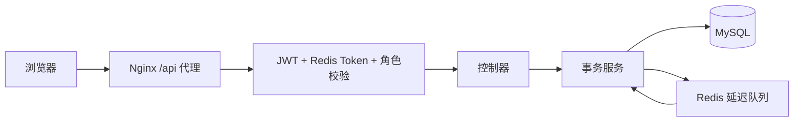

# 阅读手册

## 建议阅读顺序

1. 根目录 README：启动方式及环境要求。
2. 本手册的状态模型与事务流程。
3. `ParkingFlowService`：预约、取消、入场、出场、计费。
4. `ReservationQueue`：延迟投递、消费确认和恢复。
5. `AuthenticationInterceptor`、`AccessGuard` 与 `PaymentService`。
6. 前端路由、统一请求工具及用户预约页面。

## 目录结构

| 目录 | 用途 |
| --- | --- |
| `parking/parking` | Maven 后端；Java 源码、MyBatis XML、配置示例、测试 |
| `vue3/parking-vue` | Vue 前端；页面、API 封装、状态和资源 |
| `database/init` | 新建数据库结构；仅空数据卷首次启动执行 |
| `database/migrations` | 保留旧业务数据的升级脚本 |
| `deploy` | 前后端 Dockerfile 与 Nginx 配置 |
| `scripts` | 本地配置初始化、验证及迁移检查脚本 |
| `docs` | 中文手册和验证记录 |

原有前后端源码目录保持不变。外层遗留 JAR、个人配置和压缩备份不参与构建及发布。

## 请求和权限

用户权限为 `-1`，停车场管理员为 `0`，超级管理员为 `1`。登录 Token 同时需要签名有效、未过期且等于 Redis 保存的当前 Token。重新登录、登出及重置密码使旧 Token 失效。

所有业务接口默认要求登录。登录、用户注册、支付宝验签回调及健康检查为明确的例外。管理员注册不对匿名请求开放，首次超级管理员从环境变量创建。

前端路由守卫用于页面访问体验；实际授权由后端负责。停车场管理员操作车位、出入场及停车场资料时需要校验所属关系。

## 数据关系

- `admin` 管理停车场；停车场关联共享 `rule`。
- `spaces` 表同时表示车位和地图元素：`0` 空闲、`1` 占用、`2` 道路、`3` 墙壁、`4` 出入口。
- `enter` 同时保存预约与停车过程，使用独立的 `reserved_at`、`expires_at` 和 `enter_time`。
- `enter.space_id` 关联车位；`spaces.active_enter_id` 指向当前有效记录，释放时必须同时匹配。
- `orders` 保存离场费用；`recharges` 保存支付状态及流水。
- `reservation_event` 保存待投递和待完成的到期事件，不依赖进程内存保存业务事实。

有效用户、有效车位的唯一索引防止同一资源被重复占用。服务先锁用户，再锁停车场及关联记录；同一停车场的地图编辑也锁停车场，避免与预约争抢。

`park_mount`、`park_spare` 从实际地图中的车位计算。道路、墙壁和出入口不计入容量。客户端提交的容量不能覆盖真实预约计数。

## 预约状态模型

| 状态 | flag | reservation | 到期消费者行为 |
| --- | --- | --- | --- |
| 有效预约 | 0 | 1 | 已到期时取消并释放原车位 |
| 手动取消或过期 | 0 | 2 | 幂等结束，不再释放 |
| 未预约入场 | 1 | 0 | 不处理 |
| 预约后入场 | 1 | 1 | 不释放；完成到期事件 |
| 已离场 | 2 | 0/1 | 不处理 |

预约减少一个可用车位。预约转入场使用原车位，不重复减少。未预约入场按 ID 顺序选择空闲车位；离场、手动取消、到期取消各释放一次。

数据库中的到期时间是最终依据。在到期边界，`当前时间 >= expires_at` 即过期。入场与取消/过期竞争时由锁确定合法的最终状态。

## 延迟队列如何可靠工作

1. 预约事务同时写入 `enter`、车位占用及 `reservation_event`。
2. 提交后发布事件，按剩余时长投递 Redisson 延迟队列。投递失败仅重试该事件。
3. Redisson 在 Redis 内将到期 ID 转入就绪队列，不扫描 MySQL 预约表。
4. 消费者原子地将消息从就绪队列移动至处理中队列；进程崩溃不会立即丢掉这条消息。
5. 事务内重新检查预约状态、时间和车位关联，提交成功后才删除处理中消息。
6. 应用启动及 Redis 恢复连接时进行一次校准，重放处理中消息和数据库未完成事件。

允许重复投递，依赖幂等处理保证业务效果。不存在跨 MySQL/Redis 的分布式原子提交；事务事件表、恢复和重试覆盖这段交付间隙。Redis AOF 每秒刷盘，数据库是恢复依据。

失败事件保留 `attempts`、`last_error`。日志持续出现同一预约失败时，运维需核查关联数据；程序不会猜测并释放车位。会员和未支付充值的维护任务仍使用原有定时机制，预约扫描已移除。

## 计费与支付

金额使用 `BigDecimal` 和 `DECIMAL`。保持原有按完整分钟计算停车时长的规则：免费时长内费用为零，超过部分按计费单位向上取整。有效会员按既有规则免停车费。

离场事务锁定用户余额，保证扣费、生成订单、修改在场状态和释放车位同时成功或同时回滚。

支付宝回调先验签，再核对应用、订单、金额、支付方式及成功状态。锁定充值记录后仅进行一次入账；已在本地取消但真实支付成功的晚到回调仍会正确入账。支付流水设唯一约束，防止串单。

## 可选外部服务

- DeepSeek：请求边界捕获可信用户 ID，工具参数不接受用户身份。工具与网页共用预约事务服务；会话查询检查归属。
- 百度识别：仅处理受限大小的 JPEG/PNG 临时文件，完成后清理。
- 支付宝：当前使用沙箱网关；未启用时不会创建充值单或模拟到账。
- OSS：未配置时返回明确提示，不伪造上传成功。

AI 会话元数据保存在 MySQL，对话内容仍使用进程内 ChatMemory，重启后历史消息内容不会恢复。第三方真实连通性需在本地配置有效密钥后单独验收。
